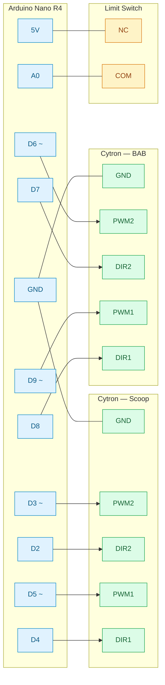

#### Linear Actuators for Scoop

| Cytron Pin | Arduino Nano R4 Pin | Description |
|---|---|---|
| GND | GND | Common ground |
| PWM2 | D3 | Motor 2 PWM (~) |
| DIR2 | D2 | Motor 2 direction |
| PWM1 | D5 | Motor 1 PWM (~) |
| DIR1 | D4 | Motor 1 direction |

#### Linear Actuators for BAB

| Cytron Pin | Arduino Pin | Description |
|---|---|---|
| GND | GND | Common ground |
| PWM2 | D6 | Motor 2 PWM (~) |
| DIR2 | D7 | Motor 2 direction |
| PWM1 | D9 | Motor 1 PWM (~) |
| DIR1 | D8 | Motor 1 direction |

#### Limit Switch

| Limit Switch Terminal | Arduino Nano R4 Pin | Description |
|---|---|---|
| NC | 5V | Normally closed contact |
| COM | A0 | Common contact / digital input |

#### Diagram

